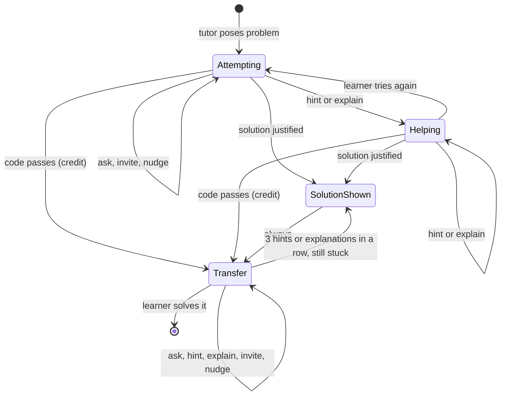

# Intervention state machine (draft)

The backend holds this. The model does not choose the next action. See ADR 0002. The code is `backend/app/policy/decide.py`.

## Rules in order

Attempting and Helping use the same rules. Apply the first match. Code with an error that stops it running counts as a failing check.

1. Valid alternative, code does not fail, first help: ask about the approach.
2. Code passes, complete attempt, no wrong belief: credit it, go to Transfer. The reply also poses the transfer problem.
3. Complete code with no check result, first help: ask once.
4. Solution: stuck, enough helped attempts, code does not pass, first low-effort message in a row, evaluator sure.
5. Wrong belief: ask the first time. Explain after the learner got help or sent a low-effort message. A guess that carries a wrong belief gets a question, then the explanation.
6. Ambiguous question, no attempt: ask.
7. Low effort (nothing written, or a guess): see the ladder below.
8. Complete code that passes but was not credited: ask.
9. Meaningful attempt, stuck: hint.
10. Otherwise: ask.

Transfer rules, in order:
1. Code passes, complete attempt, no wrong belief, evaluator sure: end.
2. Solution: all of these must hold. The learner is stuck. There were 3 hints or explanations in a row (config). The code does not pass. This is the first low-effort message in a row. The evaluator is sure. A new transfer problem follows.
3. Wrong belief: same as Attempting rule 5.
4. Meaningful attempt, stuck: hint.
5. Low effort: ladder below.
6. Otherwise: invite.

## Low-effort ladder
A low-effort message has attempt `none` (nothing written, or only "I don't know") or `guess` (no reasoning).

| Messages in a row | Action |
|---|---|
| first | invite (nothing written) or ask why (guess) |
| second | concept-level hint |
| third or later | nudge: learning needs effort, show what you tried |

A learner with no time uses Exam Mode.

## Rules for the solution
- Learn Mode only. Time, frustration, and "just tell me" are never reasons.
- Required helped attempts start at 2 (config, untested). A harder problem needs more. A first-timer needs fewer, so the solution comes sooner. A familiar learner needs more.
- Never give the solution when the code passes.
- Never give credit, an explanation, or a solution when the evaluator is uncertain.
- The fallback form is always uncertain. The caller does not call the policy for it. See `adr/0003-evaluator-interface.md`.
- After a solution, always go to Transfer. The transfer problem is similar, not identical. The policy ignores the learner's next message after a solution. The response generator may still answer a follow-up question.
- Use no fixed number of tries or minutes. Put each threshold in config, marked untested.

## Policy inputs from outside the model
- Problem difficulty: stored with each problem.
- Learner familiarity: ask at the start of a topic ("Have you seen loops before?").
- The checker must report a result. A missing result (`not_checked`) is not a pass.
- The caller keeps the history counts. See `backend/CLAUDE.md`.

## Open
- What should happen when the evaluator stays uncertain? Today the learner can wait for the solution indefinitely.
- Who checks that a transfer problem is similar but not identical?
- What happens when the learner leaves mid-session?
