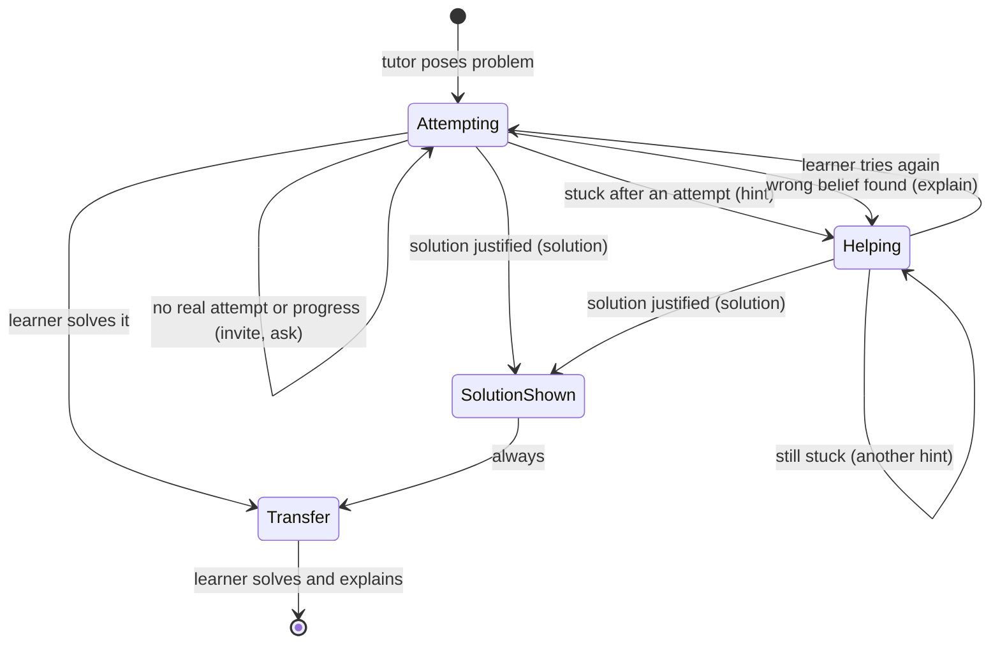

# Intervention state machine (draft)

The backend holds this. The model does not choose the next action. See ADR 0002.

## Transitions

| From | When | Action | To |
|---|---|---|---|
| Attempting | no meaningful attempt | invite | Attempting |
| Attempting | guess only | ask | Attempting |
| Attempting | meaningful attempt, stuck | hint | Helping |
| Attempting | wrong belief found | explain | Helping |
| Attempting or Helping | solution justified | solution | SolutionShown |
| Attempting | learner solves it | credit it | Transfer |
| Helping | still stuck | hint | Helping |
| Helping | learner tries again | wait for the attempt | Attempting |
| SolutionShown | always | transfer problem | Transfer |
| Transfer | learner solves and explains | end | done |

## Rules
- After a solution, always go to Transfer.
- The transfer problem is similar, not identical.
- Use no fixed number of tries or minutes. Put any threshold in config, marked untested.

## Open
- When is a solution justified? No rule yet.
- Does a learner who solves it alone also go to Transfer? The draft says yes.
- Who checks that a transfer problem is similar but not identical?
- What happens when the learner leaves mid-session?
