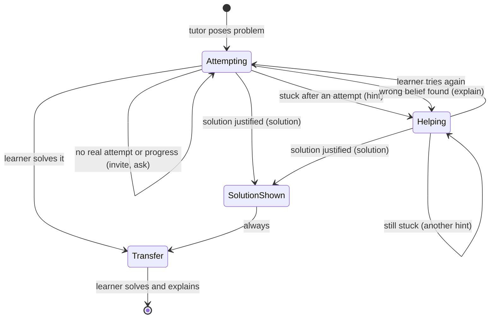

# Intervention state machine (draft)

Status: draft, not reviewed. It follows the five conversations in `scenarios.md`.

The backend holds this state machine. The model does not choose the next action.

Caption: the learner starts in Attempting. Every path that shows a solution passes through Transfer.

## States
| State | Meaning |
|---|---|
| Attempting | The learner works on the problem. The tutor invites attempts and asks questions. |
| Helping | The tutor gave a hint or explained an error. |
| SolutionShown | The tutor gave the full solution. |
| Transfer | The learner solves a similar problem alone and explains it. |

## What the policy reads
- The current state.
- The assessment of the last learner message. Examples: real attempt or not, stuck, wrong belief, valid alternative.
- The history: what the tutor already did in this session, such as how many hints it gave.
- What the learner asked for, such as "just tell me".

## Rules fixed by the brief
- After a solution, the next state is always Transfer.
- The transfer problem must be similar but not identical.
- No universal thresholds, such as a fixed number of tries or minutes.

## Open decisions
1. When is a solution justified? Scenario 4 shows one case. We have no rule yet.
2. When does "stuck" apply? What does the assessment output?
3. Does a learner who solves the problem alone also go to Transfer? The draft says yes.
4. What counts as a "similar but not identical" transfer problem, and who checks it?
5. What happens if the learner leaves in the middle of a session?
